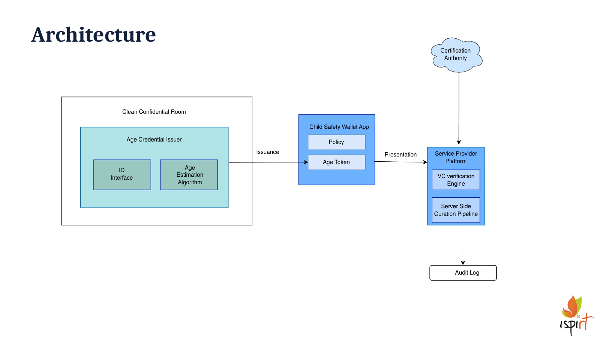
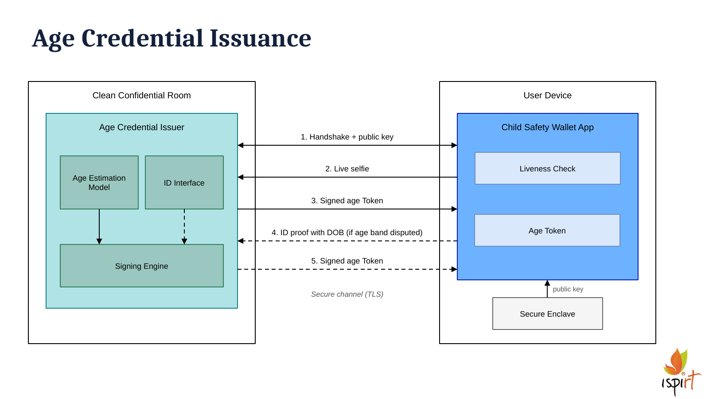
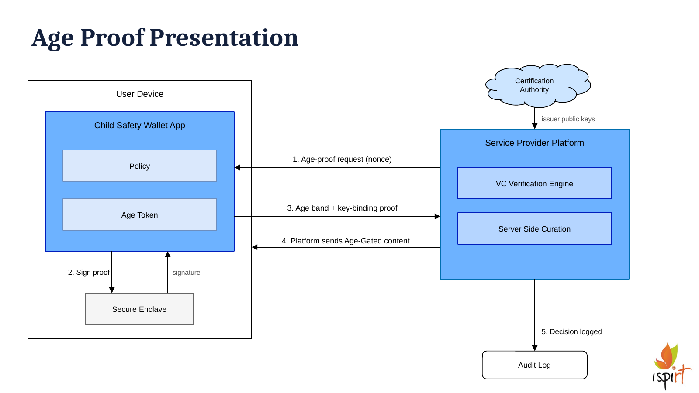

# CHAISE Child Safety Demo

> **Work in progress.** This repository is an early demo of  child safety project at IIT Delhi under Prof. Subodh Vishnu Sharma in collaboration with iSPIRT's **CHAISE** project (Children, AI and Safe Environments for
> Growth). 

> See [What works today](#what-works-today).

## The idea in brief

Many apps need to know whether a user is a child before showing certain
content. Today that usually means typing in a birth date (easy to fake) or
uploading an ID card (a lot of personal data handed to every app).

This project tries a different approach:

1. **Check age once.** The user takes a live selfie in a **wallet app** on their
   phone. A trusted **age checker** estimates an **age range** (such as 12–17 or
   18+) and gives the phone a digital **age token**, a small card signed by the
   checker so it can't be forged or edited.
2. **Prove age anywhere, without revealing who you are.** When an app asks "is
   this user 12 or older?", the wallet shares only the age range. It doesn't
   share a name, a birth date or a photo.
3. **Parents stay in control on the phone.** A parent can add rules in the
   wallet, such as "no world news" or "nothing after 9 pm". The wallet checks
   these rules before sharing anything, so the phone can block content even
   when the app itself would allow it.



## How it works

### Step 1: getting an age token



1. The wallet creates a **private key** inside the phone's secure chip (the
   Secure Enclave). The key can never be copied off the phone. The wallet sends
   only the matching public key to the age checker.
2. The wallet runs a **liveness check**: it asks the user to blink, smile, and so
   on in a random order, and uses the phone's 3D face camera to make sure a real
   face, not a photo or a screen, is in front of it. It then sends one live
   selfie.
3. The age checker's AI model estimates the age range and returns a **signed age
   token** tied to that phone's key. A token copied to another phone is useless.

Steps 4 and 5 in the picture (showing an ID if the age range is disputed) are
**planned**. So is running the age checker inside a **Clean Confidential Room**:
a sealed, verifiable computer whose operator can't see or keep the selfies.

### Step 2: using the age token



1. An app (our demo app is called **Footube**) asks the wallet for an age proof.
   The request includes a one-time random code, so an old proof can't be
   replayed.
2. The wallet checks the parent's rules. If they allow it, the secure chip signs
   the proof.
3. The wallet sends back only the age range plus that signature.
4. Footube checks that the token really came from the age checker, that it
   belongs to this phone, and that the age range is high enough. Only then does
   it show the content.

The **Certification Authority** (a public list of trusted age checkers), the
**audit log** and **server-side content curation** in the picture are
**planned**. Today the age checker's public key is built into the apps, and
Footube's articles are labelled by hand.

## What works today

| Part | Status |
|---|---|
| Live selfie with liveness check on iPhone | Working |
| AI age-range estimate and signed age token | Working (on a normal cloud server) |
| Private key kept in the iPhone's secure chip | Working |
| Sharing only the age range, with one-time codes | Working |
| Parent rules in the wallet (by topic and time of day, PIN-protected) | Working (basic) |
| Footube demo app with age-gated articles | Working |
| Age checker inside a Clean Confidential Room | Planned |
| ID check when the age range is disputed | Planned |
| Certification Authority, audit log, server-side curation | Planned |
| Android | Planned (**iPhone only for now**) |

## Try it

See **[GETTING_STARTED.md](GETTING_STARTED.md)** for step-by-step instructions to
install the two apps on your iPhone.

## Code structure

```
Child-Safety-in-AI/
├── issuer/      The age checker (Python server)
├── wallet/      The wallet app (iPhone)
├── platform/    Footube, the demo app with age-gated articles (iPhone)
└── docs/        Images used in this README
```

### `issuer/`: the age checker

A Python web server with three addresses: `/health`, `/issuance/start` (begin a
session) and `/issue` (send a selfie, get an age token).

| Folder or file | What's in it |
|---|---|
| `api.py` | The web server |
| `runtime/` | Face finding, age estimate, rules for when to refuse, building and signing the token |
| `model/` | The trained age model (about 330 MB, stored with Git LFS) |
| `detector/` | The face-finding model |
| `policy/` | Settings for the age estimate and when to refuse |
| `tests/` | Automated tests |

### `wallet/`: the wallet app

Built with Expo / React Native. The main code is in `wallet/src/`.

| Folder | What's in it |
|---|---|
| `app/` | The screens: home, get an age token, approve a request, Policies tab, Settings |
| `liveness/` | The blink-and-smile liveness check |
| `crypto/` | Storing the token, and building the proof that only shares the age range |
| `policy/` | Parent rules: how they're stored and checked |
| `api/` | Talking to the age checker |
| `config/` | The age checker's address, and the list of apps the wallet will talk to |
| `../modules/` | Small pieces of native iPhone code: the secure-chip key and the 3D face camera |

### `platform/`: the Footube demo app

Also Expo / React Native. The main code is in `platform/src/`.

| Folder | What's in it |
|---|---|
| `app/` | The screens: article list, article page, and the screen that receives the wallet's answer |
| `content/` | The demo articles, and the rule for who can open what |
| `verifier/` | Checking the age proof: signature, phone key, one-time code, age range |

The wallet and Footube talk to each other through links that open one app from
the other (`childsafewallet://…` and `footube://…`). There's no server between
them.

## Known limitations

- **iPhone only**, and it needs Face ID (iPhone X or newer). The iOS Simulator
  can't run the liveness check.
- The age checker makes a **new signing key every time it restarts**, and that
  key is built into both apps. After a restart, both apps need updating.
- Parent rules are protected by a PIN only and aren't signed.
- Apps installed with a free Apple account **stop opening after 7 days** and need
  reinstalling.
